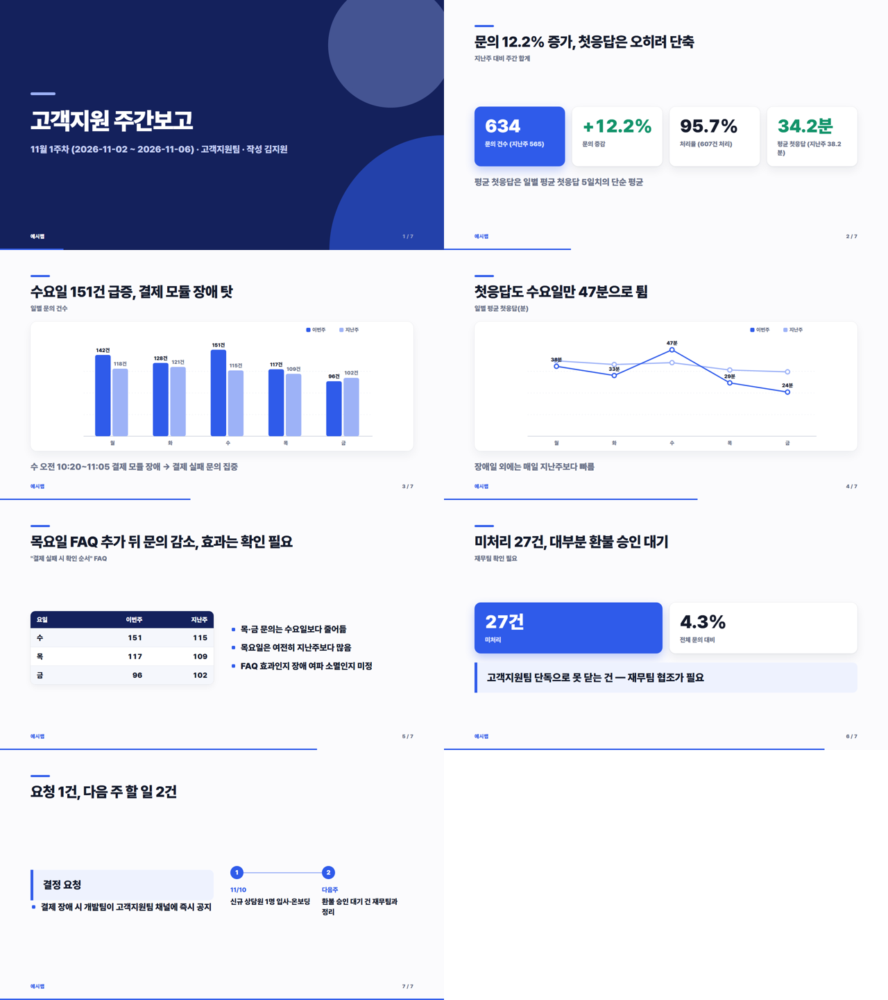

# claude-slides

회의 자료(CSV·회의록·기획 문서)를 주면 Claude Code가 **회사 공통 테마의 HTML 발표 덱 + PDF**를 만든다.
Claude는 슬라이드 내용만 쓰고, 디자인과 검사는 코드가 맡는다.



```
자료 파일 ──▶ Claude Code (make-deck 스킬) ──▶ decks/<이름>/slides.html
                                                   │
                         python build.py ◀─────────┘
                         ├ theme/theme.css·deck.js 인라인 → <이름>.html (오프라인 단일 파일)
                         ├ Playwright 로 PDF           → <이름>.pdf
                         └ 검사: 숫자 출처 / 슬라이드 넘침 / PDF 쪽수  → 하나라도 걸리면 다시
```

## 쓰는 법

```bash
pip install playwright && playwright install chromium
claude    # 이 폴더에서 열면 .claude/skills/make-deck 이 잡힌다
> samples/04_분기실적.csv 로 3분기 실적 리뷰 발표자료 만들어줘
```

비대화형:

```bash
claude -p "samples/02_회의록.txt 로 회의 결과 공유 발표자료 만들어줘. 덱 이름은 회의록" \
  --allowedTools "Read,Glob,Grep,Skill,Bash(python:*),Edit(decks/**)"
```

**끝나면 `verify.py` 로 확인한다.** 덱을 만든 세션이 검사기(`build.py`·`theme/`·`test_build.py`)를 고쳤는지 git 으로 대조하고,
바뀌었으면 원본으로 되돌려 실패 처리한 뒤 원본 검사기로 다시 검사한다.

```bash
python verify.py decks/회의록 samples/02_회의록.txt
```

`--allowedTools` 는 "묻지 않고 허용할 목록"일 뿐 칸막이가 아니다. 권한 모드가 `auto` 인 환경에서 위 플래그를 준 세션에
"build.py 를 고쳐라"라고 시켰더니 Edit 도구로도, python 으로도 고쳐졌다. 그래서 막는 대신 끝난 뒤 코드로 확인한다.

HTML 은 브라우저로 열고 ← → / 스페이스 / 클릭으로 넘긴다.

## 숫자 검사

AI가 만든 발표자료에서 제일 무서운 건 그럴듯한 가짜 숫자다. `build.py` 는

- 덱에 나온 두 자리 이상 숫자가 원본 자료에 **그대로** 있는지 보고,
- 계산한 숫자는 `<b data-calc="(634-565)/565*100">12.2%</b>` 처럼 계산식을 달게 해서 직접 다시 계산한다(식 안의 숫자도 원본에 있어야 한다).

```
  ✗ 계산 불일치: 142+128+151+117+96 = 634.0000 인데 덱에는 643
  ✗ 원본에 없는 숫자: 175
```

`python test_build.py` 로 검사기 자체를 확인한다.

## 폴더

| 경로 | 내용 |
|---|---|
| `.claude/skills/make-deck/SKILL.md` | Claude가 따르는 규칙과 슬라이드 부품 |
| `theme/` | 공통 테마(색·폰트는 `theme.css` 맨 위에서만 바꾼다), 넘김·차트 JS |
| `build.py` | 조립 + PDF + 검사 |
| `verify.py` | 세션이 끝난 뒤 검사기 무결성(git) 확인 + 재검사 |
| `samples/` | 예시 자료 4종 — **가상 회사 '예시랩'의 지어낸 데이터** |
| `decks/` | 위 자료로 실제 만든 덱(HTML·PDF) |

## 한계

- 한 자리 숫자는 검사하지 않는다(쪽번호·"3개" 오탐 때문). 그래서 "11/6" 은 통과하고, "11/06"·"11/27" 은 원본에 없으면 걸린다.
- 슬라이드가 보기 좋은지는 검사하지 않는다. 스크린샷으로 직접 본다.
- 글꼴은 Pretendard → 맑은 고딕 순으로 쓴다(오프라인이라 웹폰트를 싣지 않는다). 설치된 글꼴에 따라 글자 폭과 넘침 검사 결과가 달라질 수 있다.
